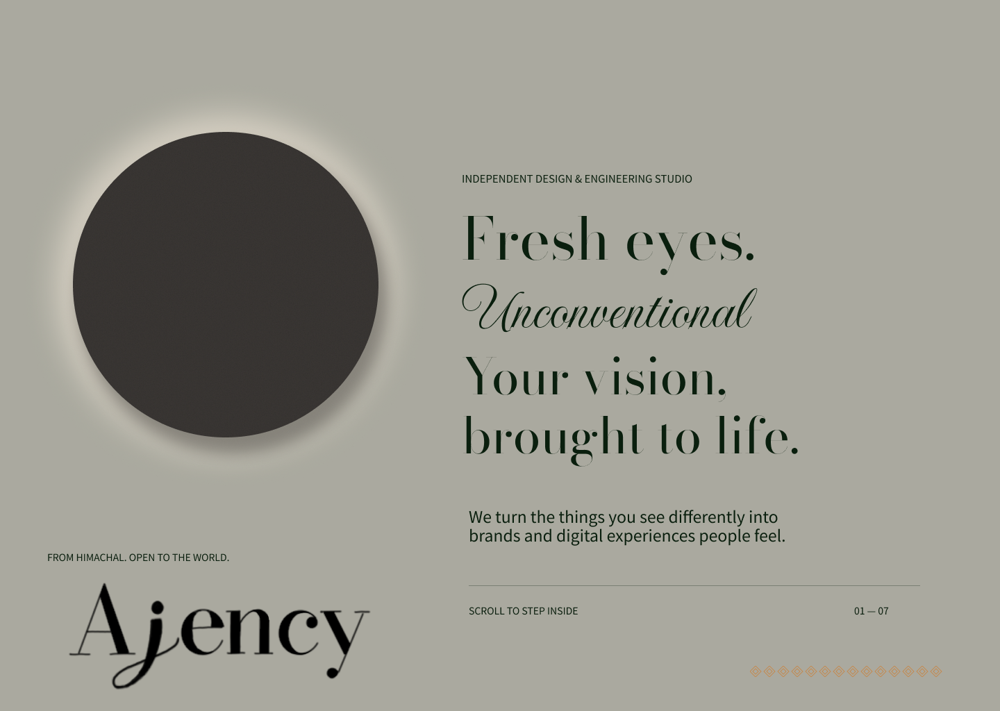

# Ajency

Website design and interface system for Ajency, with an Aeka website case study in `casestudy/`.

**Status:** core Ajency design is substantially complete; content and visual refinement are ongoing. This repository presents design work and does not claim a launched website or validated business outcomes.

## Explore

- [Ajency website gallery](website/README.md) — homepage, work, studio, booking journey, components and interaction studies.
- [Visual foundations](foundations/README.md) — typography, colour and visual direction.
- [Aeka website case study](casestudy/aeka.md) — a separate UI/UX case study, not a pre-launch client delivery.
- [Figma source](https://www.figma.com/design/TCnm3IN17p7lpmcS4UzMXe) — editable design and prototype.

## Homepage prototype

## Design scope

- Typography-led visual hierarchy and an atmospheric light-and-shadow direction.
- Work presentation, studio information and a multi-step enquiry and booking journey.
- Reusable interface components and motion-state studies.

## Files

`website/screens/` contains website and interaction exports. `foundations/screens/` contains the foundations board. `casestudy/aeka/screens/` contains the Aeka case-study screens. Each gallery links back to its original Figma frame.

Exports are static snapshots from 30 October 2026; interactive behaviour lives in Figma. The [manifest](export-manifest.json) records their source frames, dimensions and checksums. Figma sharing permissions are unchanged.
