# Aeka film photography website case study
A UI/UX case study for a film-photography storefront, exploring product discovery, learning content, dealer enquiries and a purchasing journey. This is presented as a case study, not as a launched or pre-launch client website. No usability-study results or conversion improvements are claimed.

The gallery includes foundations and 14 page designs, including home, shop, product detail, editorial content, dealer enquiry, cart and checkout.

Exports captured on 30 October 2026. Figma links open the editable source with its existing access settings.

## 00 — Foundations
[Open source frame in Figma](https://www.figma.com/design/XcB8uWQPuzDEtjFR3ISXIw?node-id=4-21)

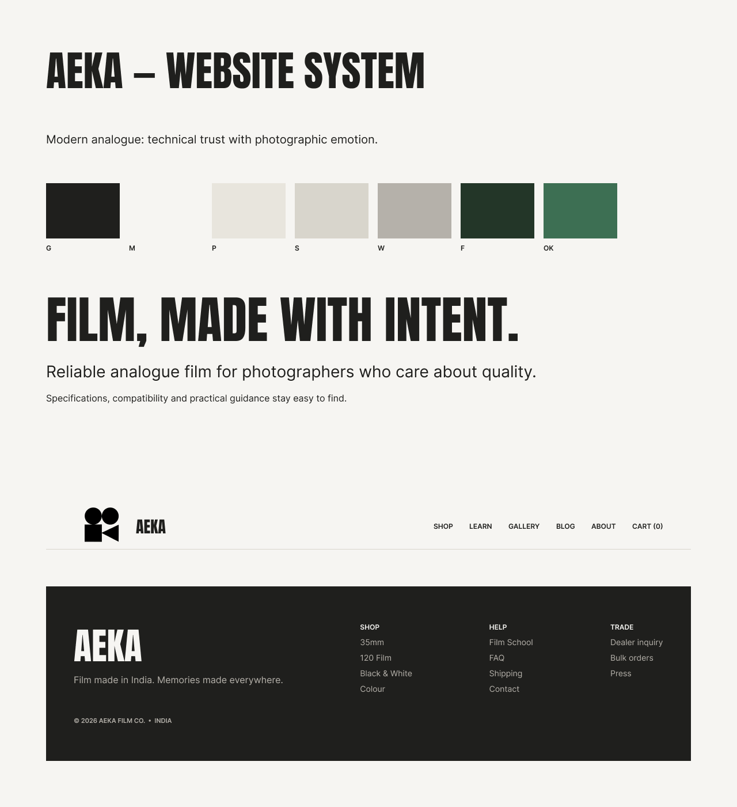

## 01 — Home
[Open source frame in Figma](https://www.figma.com/design/XcB8uWQPuzDEtjFR3ISXIw?node-id=4-22)

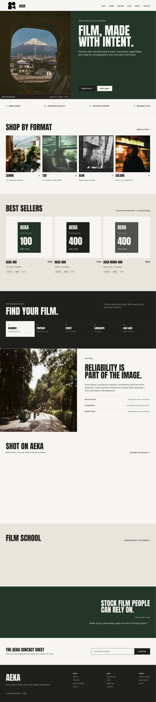

## 02 — Shop
[Open source frame in Figma](https://www.figma.com/design/XcB8uWQPuzDEtjFR3ISXIw?node-id=4-23)

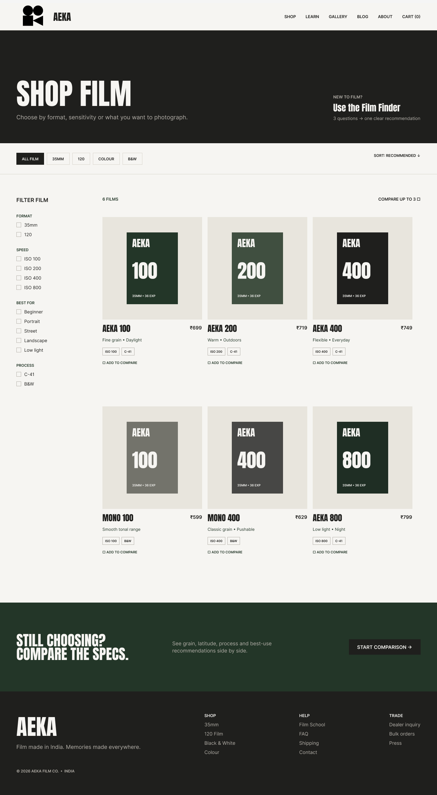

## 03 — Product Detail
[Open source frame in Figma](https://www.figma.com/design/XcB8uWQPuzDEtjFR3ISXIw?node-id=4-24)

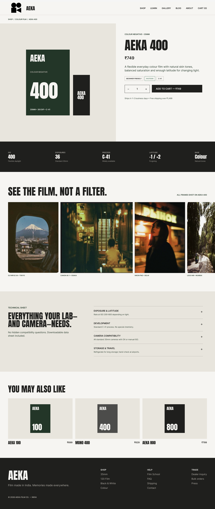

## 04 — Learn
[Open source frame in Figma](https://www.figma.com/design/XcB8uWQPuzDEtjFR3ISXIw?node-id=4-25)

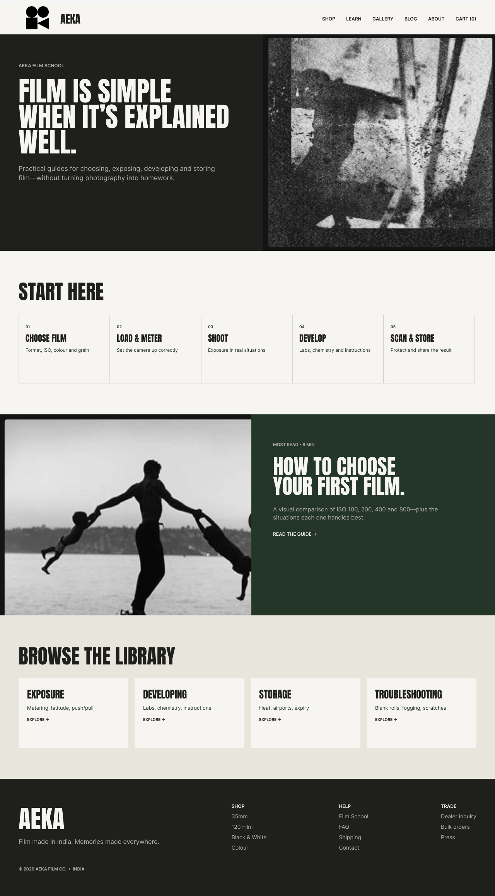

## 05 — Gallery
[Open source frame in Figma](https://www.figma.com/design/XcB8uWQPuzDEtjFR3ISXIw?node-id=4-26)

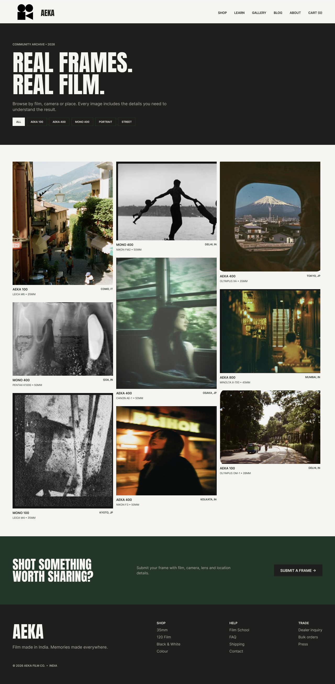

## 06 — About
[Open source frame in Figma](https://www.figma.com/design/XcB8uWQPuzDEtjFR3ISXIw?node-id=4-27)

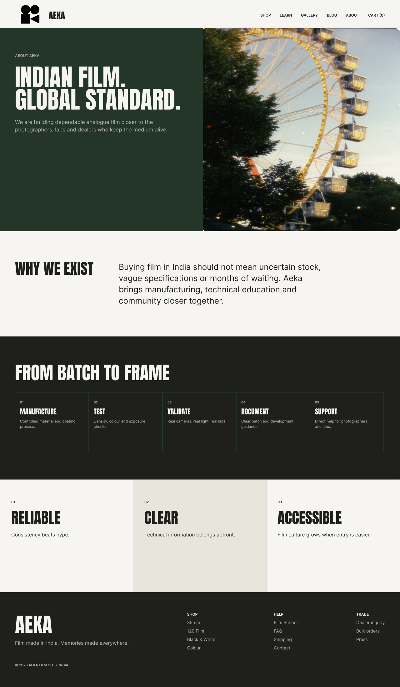

## 07 — Blog
[Open source frame in Figma](https://www.figma.com/design/XcB8uWQPuzDEtjFR3ISXIw?node-id=4-28)

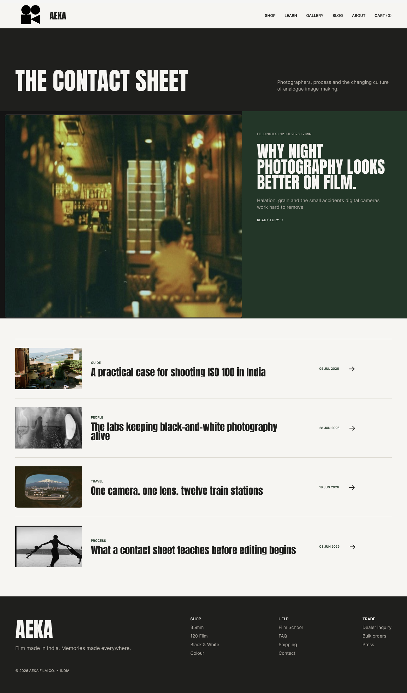

## 08 — Dealer Inquiry
[Open source frame in Figma](https://www.figma.com/design/XcB8uWQPuzDEtjFR3ISXIw?node-id=4-29)

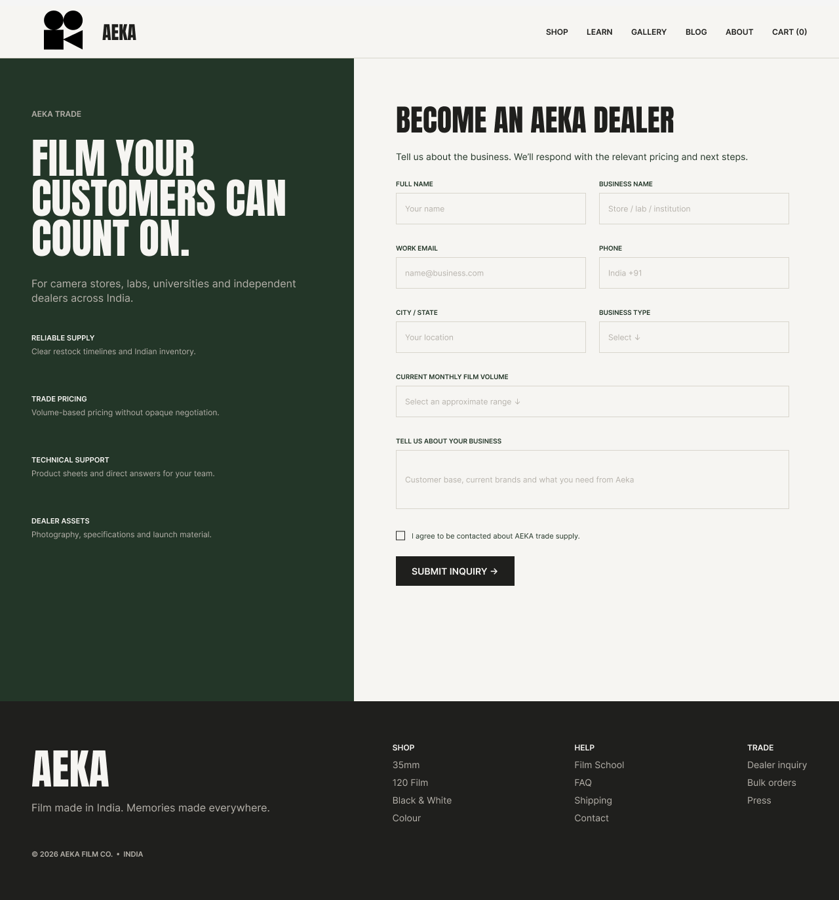

## 09 — Cart
[Open source frame in Figma](https://www.figma.com/design/XcB8uWQPuzDEtjFR3ISXIw?node-id=4-30)

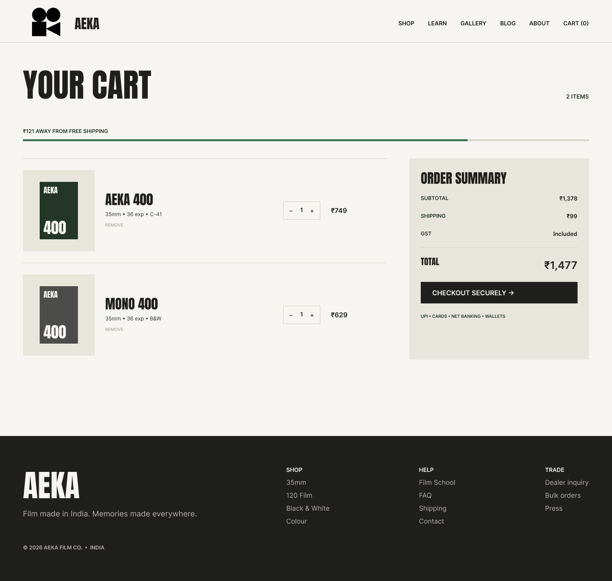

## 10 — Checkout
[Open source frame in Figma](https://www.figma.com/design/XcB8uWQPuzDEtjFR3ISXIw?node-id=4-31)

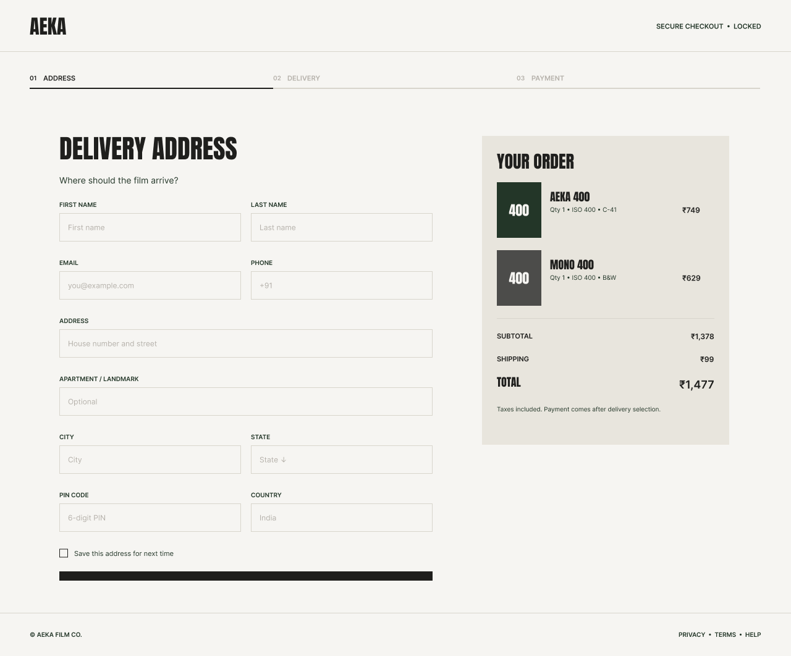

## 07a — Blog Article
[Open source frame in Figma](https://www.figma.com/design/XcB8uWQPuzDEtjFR3ISXIw?node-id=40-302)

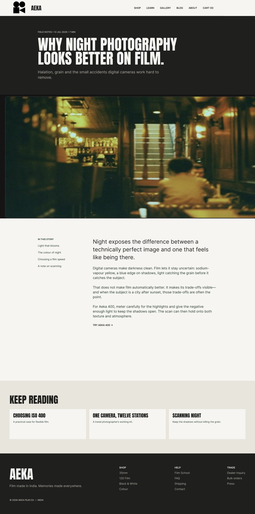

## 08a — FAQ
[Open source frame in Figma](https://www.figma.com/design/XcB8uWQPuzDEtjFR3ISXIw?node-id=40-303)

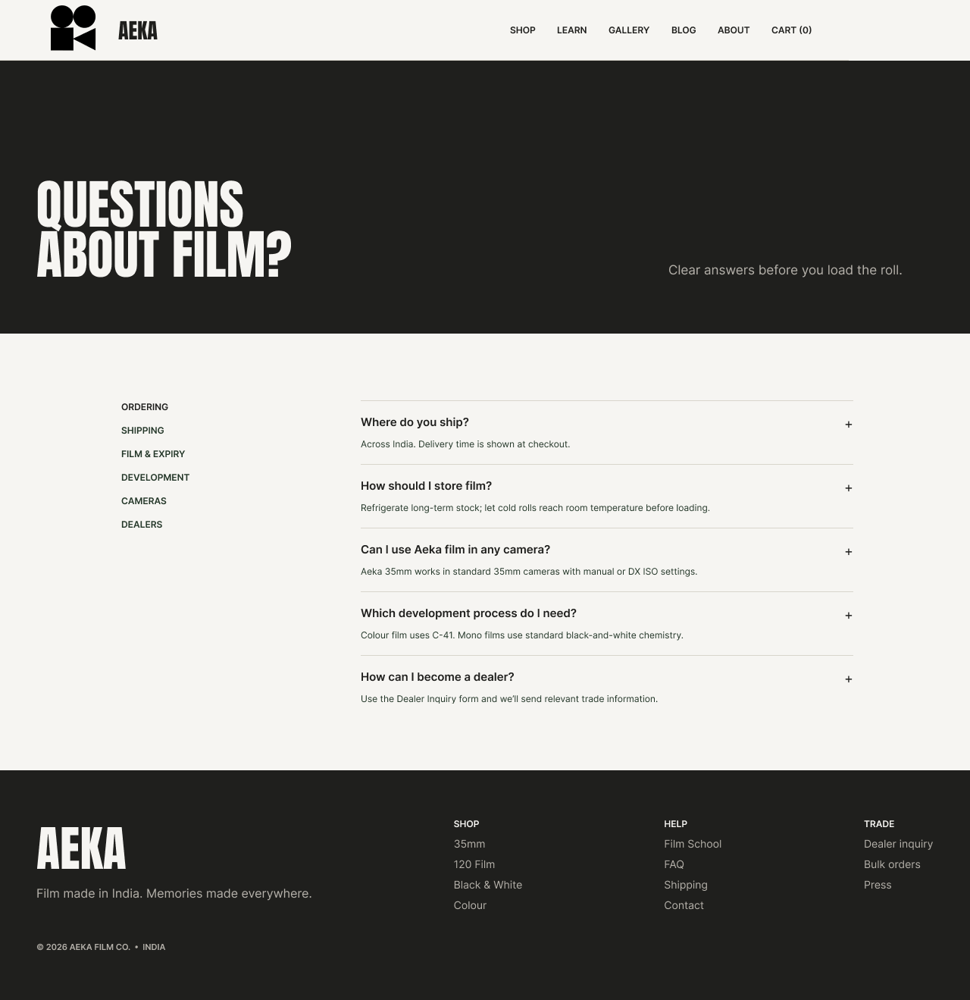

## 08b — Contact
[Open source frame in Figma](https://www.figma.com/design/XcB8uWQPuzDEtjFR3ISXIw?node-id=40-304)

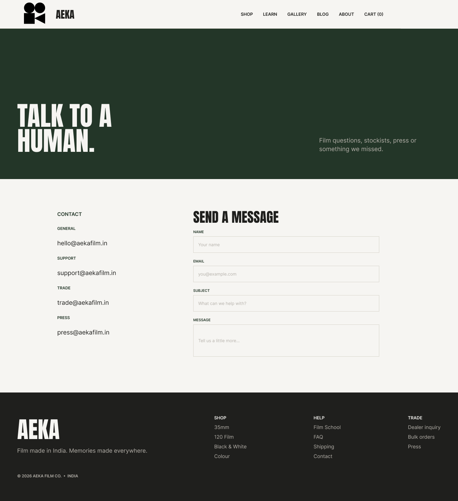

## 11 — Order Success
[Open source frame in Figma](https://www.figma.com/design/XcB8uWQPuzDEtjFR3ISXIw?node-id=40-305)

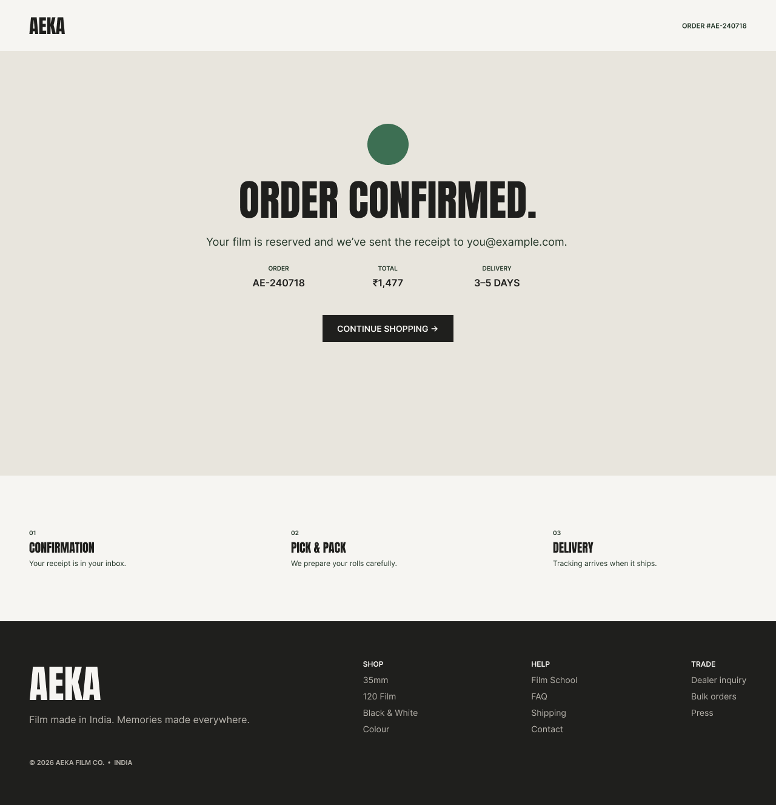
